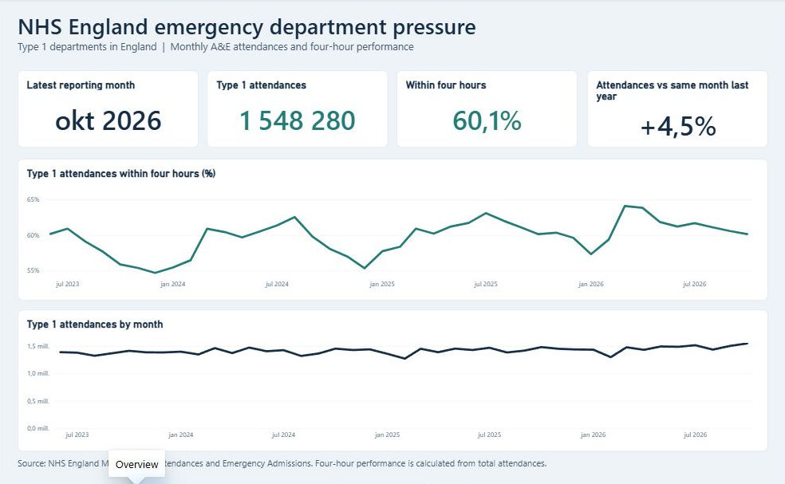

# NHS Emergency Department Pressure

A data engineering project exploring patient demand, four-hour performance and emergency admissions across NHS England's **Type 1 emergency departments**. The verified snapshot covers June 2023 to October 2026.

## Questions
- How do attendances and waiting times change over time?
- How does performance differ between reporting organisations?
- How do long A&E stays and emergency admissions via Type 1 change over time?

## Data and approach
- **Source:** Monthly NHS England A&E CSV files, from June 2023 onwards; NHS organisation data where useful.
- **Pipeline:** Manual raw-file upload → Databricks Free Edition → Bronze / Silver / Gold Delta tables using PySpark and SQL.
- **Orchestration:** Databricks Jobs for the transformation pipeline.
- **Reporting:** Power BI Desktop (Databricks Import connection if available; CSV export as fallback).

## Power BI report

**Overview** shows England-wide demand, the share of attendances within four hours and year-over-year demand for the latest month. [Organisation Comparison](docs/screenshots/organisation-comparison.png) filters the provider table by month and NHS region. [Patient Flow](docs/screenshots/patient-flow.png) shows Type 1 attendances over four hours and emergency admissions via Type 1.

## Reproduce the project

1. Run `python scripts/prepare_nhs_history.py` to download and validate the 43 source releases and build the upload bundle.
2. Set up the Unity Catalog schema and volume and load the bundle using the [historical run guide](docs/historical-run.md). Use the [Databricks Job runbook](docs/databricks-job.md) to rerun the notebook on Serverless compute.
3. Open the [Power BI project](powerbi/nhs-ed-pressure.pbip) in Power BI Desktop. Enter the SQL warehouse details under **Home → Transform data → Edit parameters**, then refresh. See the [report setup and checks](docs/power-bi-report.md).

## Verified results and limits

The validated bundle produced **8,112 organisation-month rows** across **41 months**. A June 2023 revision replaced the complete month, and rerunning the same bundle preserved the row counts. The workspace owner confirmed the Serverless job succeeded. The October 2026 report matched NHS England's 1,548,280 Type 1 attendances, 617,001 over four hours, 60.1% within four hours and 408,428 emergency admissions via Type 1. [Source checks and methodology](docs/nhs-input-validation.md)

The percentage is calculated from summed counts. Provider names and regions are as published for the selected month and can change between releases. The CSV's decision-to-admit delay counts cover all A&E types and are excluded from the Type 1 report. The historical bundle is a fixed snapshot and is uploaded manually.

## CV summary

Built and verified a PySpark and Delta Lake pipeline on Databricks for 41 months of NHS England emergency department activity. Handled source revisions and reconciled monthly provider counts with NHS totals. Orchestrated the load with a Serverless job and built a three-page Power BI report.
